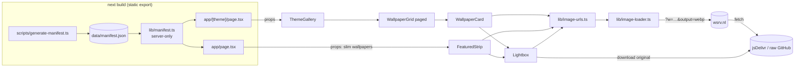
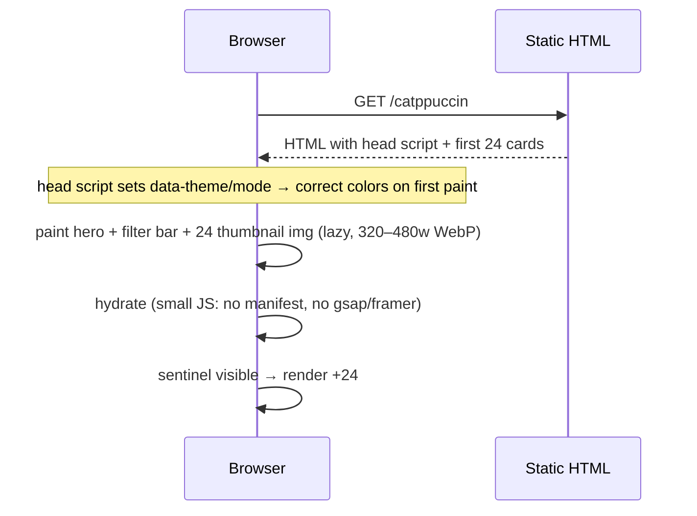
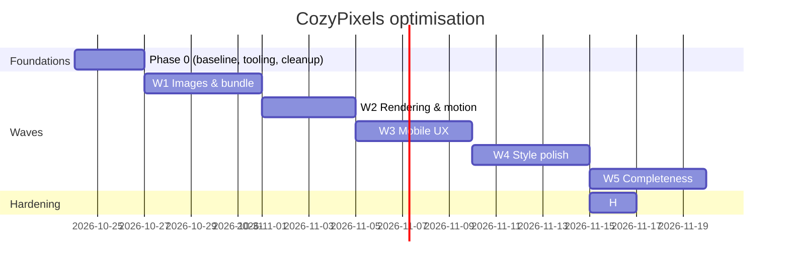

# CozyPixels Web — Optimisation Plan (performance · mobile · style)

| | |
|---|---|
| **Product** | CozyPixels Web: a free, static gallery for the SleepyCatHey/CozyPixels wallpaper collection |
| **Goal of this plan** | Make it fast and properly mobile-first, and polish the style without changing its identity (`idea.md`). Then close the other gaps found in [D]: sharing/SEO, credits/license, deep links, downloads, CI |
| **Stack** | Next.js 16.3 (App Router, `output: "export"`) · React 19.2 · Tailwind v4 · lucide-react · pnpm 11 |
| **Data / source of truth** | `data/manifest.json` generated from the GitHub tree API at build. Images are served from jsDelivr / raw.githubusercontent |
| **Hosting** | GitHub Pages (live demo, `basePath /CozyPixel.web`) and Vercel (no basePath) |
| **Open questions** | None blocking. Every gap is settled by an assumption in §3. |
| **Plan version** | v1.1 · 2026-10-23 (A-11 budgets revised after Wave 2 measurements) |

### Document map

| File | Contents |
|---|---|
| `docs/PLAN.md` | This plan |
| `docs/plan/waves.md` | The backlog: every wave broken into stories |
| `docs/plan/component-catalogue.md` | Routes and components: what each owns, and its status per story (replaces the template's API catalogue; there is no API) |
| `docs/plan/data-usage.md` | How each screen uses the manifest and image URLs; what changes (replaces the template's schema usage) |
| `docs/analysis/A_performance.md` · `B_mobile.md` · `C_style.md` · `D_completeness.md` | Analysis, cited as **[A] [B] [C] [D]** |
| `docs/source/` | Goal + baseline measurements (frozen) |

---

## 1. What we are building

An improved version of the existing site, serving the three goals plus the completeness gaps:

- **Fast**: thumbnails instead of originals, minimal client JS, no hydration-gated paint, paged grids.
- **Mobile-first**: 2-column phone grid, sticky compact filters, a swipeable lightbox, 44 px touch targets and correct viewport units.
- **Polished style, same identity**: accessible palette tokens, a richer theme-page header, loading shimmer, consistent radius/focus/type scale, a mobile hero visual and a styled 404.
- **Complete** [D]: per-page metadata + OG image + sitemap/robots; LICENSE; About/credits page with a visible takedown link; deep links for filters and the open wallpaper; download progress/errors and file info; random wallpaper + copy link; "last updated"; a CI quality gate, scheduled manifest refresh and resilient manifest step; PWA manifest (installable icon only, no offline caching).

**Not in this phase** (each plugs in later without rework):
- Cross-theme search page (`/search`) [D §4.1]: the deep-link format (A-20) already allows `?q=`, so it is a new route over the same filter code.
- Resolution/aspect badges: needs width/height in the manifest (a generator change).
- Offline/service-worker caching.
- Build-time thumbnail generation (ADR-01 keeps it as the fallback path).

## 2. What the analysis tells us

| # | Finding | How we handle it |
|---|---|---|
| F1 | Originals load everywhere: ~23 MB on home, 12.6 MB preloaded on `/catppuccin` [A §1.1–1.3] | Custom `next/image` loader serving resized WebP (A-01); originals only for download |
| F2 | Hidden mobile hero preloads 3.7 MB [A §1.4]; `priority` deprecated [A §1.5] | Remove `priority`. Only the real LCP image gets `fetchPriority="high"`. Nothing hidden is preloaded |
| F3 | Full manifest (336 KB chunk) in client JS [A §2.1] | Split `lib/manifest.ts` (server-only data) from `lib/image-urls.ts` (pure helpers) (A-09) |
| F4 | Page invisible until hydration; hero text starts at opacity 0 [A §3.1–3.2] | Inline theme script in `<head>`; drop the `visibility:hidden` wrapper; CSS entrance animations (A-06, A-05) |
| F5 | All 383–413 cards rendered at once; 1.1 MB HTML [A §3.3] [B §2.2] | Paged grid: 24 first, +24 on scroll (A-03) |
| F6 | GSAP only drives Lenis; framer-motion per card; ticker leak [A §2.2–2.5] | Remove GSAP and framer-motion; Lenis desktop-only, lazily loaded (A-04, A-05) |
| F7 | `*` transition; heavy blurs and noise [A §3.4–3.6] | Scoped theme-switch transition (A-07); lighter effects below `md`, same look (A-08) |
| F8 | 1-column phone grid, non-sticky filters, small targets [B §2] | A-02, A-10, W3 stories |
| F9 | Lightbox not touch-friendly, loads originals, no focus mgmt [B §3] | Lightbox rework (W3-03) with screen-sized image (A-01) |
| F10 | Catppuccin Latte primary 1.80:1; other tokens < 4.5 [C §2] | Token-only fixes to official palette values (A-14) |
| F11 | Inconsistent radius, focus, headings; flat theme pages; empty loading boxes [C §3–4] | W4 style stories (A-15) |
| F12 | One 23 MB original fails on jsDelivr [A §1.8] | Originals > 20 MB use raw.githubusercontent (A-13) |
| F13 | `prebuild` hits GitHub API every build [A §4.1] | Add `build:local` that skips manifest regeneration (P0-02) |
| F14 | No OG/social image, no per-page metadata, sitemap or robots [D §1] | Static metadata files + per-theme `generateMetadata` (A-19, W5-01) |
| F15 | No LICENSE despite "MIT"; takedown notice footer-only; no About page [D §2] | LICENSE (A-18), `/about` page, header link (W5-02) |
| F16 | Filters and open wallpaper can't be shared or survive refresh [D §4.2] | URL search params (A-20, W5-03) |
| F17 | Downloads silent and slow on mobile; no file info [D §4.3, §4.5] | Progress state, error toast, size/format shown (W5-04) |
| F18 | CI deploys with no checks; content refresh only on push; manifest step brittle [D §5] | CI gate, cron refresh, fallback to committed manifest (A-21, W5-05) |
| F19 | Cheap nice-to-haves missing [D §3] | Random, copy link, last updated, PWA manifest (A-22, W5-06) |
| F20 | Raw filenames in alt text [D §1.4] | `lib/format.ts` display names in `alt` (W3-01) |

## 3. Working assumptions

Each is a setting or a single code path, so it can change later without rework.

| ID | Topic | Assumption | Basis |
|---|---|---|---|
| A-01 | Thumbnail source | `next/image` custom loader (`images.loader: "custom"`, `loaderFile: "./lib/image-loader.ts"`) that rewrites to the free **wsrv.nl** proxy: `https://wsrv.nl/?url=<jsDelivr url>&w=<width>&q=<q>&output=webp`. Grid/cards use widths 320–960; lightbox uses up to 2560. Download and "GitHub" always use the original. If the proxy fails (`onError`), the image falls back to the jsDelivr original. Swapping provider = edit one file. | `docs:export` L168–180; `context.md` §2 ($0, images stay on GitHub); [A §1.6–1.7] |
| A-02 | Phone grid | 2 columns below `sm` (gap 8–12 px, compact footer); 2 at `sm`, 3 at `lg`, 4 at `xl` (unchanged above `sm`). | [B §2.1] |
| A-03 | Paging | Render 24 cards first, then +24 when an IntersectionObserver sentinel nears the viewport. A visible "Load more" button is the fallback. Reset to 24 on filter/search change. The lightbox navigates the full filtered list, not just rendered cards. | [A §3.3] [B §2.2] |
| A-04 | Smooth scroll | Keep Lenis **only** when `(pointer: fine)` and not `prefers-reduced-motion`. Load it with dynamic `import()` after mount, use Lenis `autoRaf`, and remove GSAP. Stop Lenis while the lightbox is open. | [A §2.2, §2.4, §3.6] [B §3.7] |
| A-05 | Motion library | Remove framer-motion. Card lift uses CSS `transform` with a spring-like `cubic-bezier(.34,1.56,.64,1)`, applied only under `@media (hover: hover)`. Hero stagger uses CSS `@keyframes` with `animation-delay`, so content is visible before JS. Everything respects `prefers-reduced-motion`. | [A §2.5, §3.2] [C §1.8, §3.7] |
| A-06 | Theme no-flash | A tiny inline `<script>` in `<head>` reads localStorage + `prefers-color-scheme` and sets `data-theme`/`data-mode`/`.dark` before first paint. `ThemeProvider` reads the attributes on mount and never hides children. | [A §3.1] |
| A-07 | Theme-switch transition | Remove the `*` transition. On switch, add `html.theme-switching` for 300 ms, which enables color transitions only during that window. | [A §3.4] |
| A-08 | Effects on mobile | Below `md`: glow orbs at `blur-3xl` and 60 % size without `mix-blend`, and the noise overlay switches from a fixed full-screen layer to a `background-image` on `body`. Above `md`: unchanged. Change only if P0-02 profiling shows paint cost; otherwise log "not needed" in TRACKER §4. | [A §3.5] [C §1.4–1.5] |
| A-09 | Data in client | Client components receive only `{id, theme, subcategory, filename, path, size}` via props and import URL helpers from `lib/image-urls.ts`. `lib/manifest.ts` starts with `import "server-only"`. | [A §2.1] |
| A-10 | Touch targets | All interactive elements ≥ 44 × 44 px hit area on touch (visual size may be smaller via padding/`::after`). | WCAG 2.5.5; [B §2.5] |
| A-11 | Performance budgets | **v1.1 (2026-10-23)**: Lighthouse **mobile** preset (default throttling) against the static build, every route: Performance ≥ 90, **observed LCP ≤ 1.0 s and simulated LCP ≤ 3.5 s**, TBT ≤ 200 ms, CLS ≤ 0.05. Initial image transfer ≤ 1.5 MB. Client JS (gz) ≤ **160 KB** (≈140 KB React/Next runtime + ≤ 20 KB site code). *v1.0 had simulated LCP ≤ 2.5 s and JS ≤ 150 KB; both were set before measuring and sit below the framework's own floor (see TRACKER §4).* | [A §6]; web.dev Core Web Vitals; Wave 2 measurements |
| A-12 | Target viewports | 360×740, 390×844, 768×1024, 1280×800, 1920×1080. Browsers: Chrome Android, Safari iOS (manual check at the H gate), desktop Chrome/Firefox. | [B §7] |
| A-13 | Oversized originals | Wallpapers with `size > 20 MB` use raw.githubusercontent for both proxy source and download. Implemented in `getImageUrl`. | [A §1.8] |
| A-14 | Palette fixes | Use official palette values where the current token fails 4.5:1 for text. Catppuccin Latte `primary` → Latte Mauve `266 85% 58%`; Nord dark `primary` → `nord8` `193 43% 67%`; Nord light / One Dark light `primary` darkened (lightness only) to ≥ 4.5; Catppuccin Latte `muted-foreground` → Latte Subtext0 `233 10% 47%` (verify ≥ 4.5). Dark palettes otherwise unchanged. | [C §2], `BL §4` |
| A-15 | Scope of "improve style" | Exactly the items in [C §3–4]: radius scale, focus ring, fluid headings, theme-page hero, chips with counts, shimmer + fade-in, mobile hero visual, card footer, 404/empty states, per-theme `theme-color`. The identity list [C §1] is a hard constraint. | `idea.md`; [C §1] |
| A-16 | Deploy targets | Every story must build for both targets: `pnpm build` (Pages basePath) and `pnpm build:preview` (no basePath, as on Vercel). The image loader produces absolute URLs, so basePath does not affect it. | `next.config.ts:L5` |
| A-17 | Site URL | `metadataBase` comes from `NEXT_PUBLIC_SITE_URL`, defaulting to `https://vishank020.github.io/CozyPixel.web`. Canonical URLs point to it. Sitemap/robots/OG use the same value. | README live-demo link |
| A-18 | License | MIT, `Copyright (c) 2026 Vishank Singh` (git author), covering **this frontend code only**. The README states that wallpapers are not covered and links to the source repo. Change holder = edit one line. | `ctx §1`, `§4`; [D §2.1] |
| A-19 | Social image | One static 1200×630 `app/opengraph-image.png` (a collage of three wallpapers, logo and tagline, made once and committed) plus per-theme `opengraph-image` files. No runtime generation (static export). | [D §1.2] |
| A-20 | Deep links | Theme pages read and write `?sub=<subcategory slug>&q=<text>&w=<wallpaper id>` with `history.replaceState` (filters) and `pushState` (opening the lightbox, so Back closes it). Reading params needs a `Suspense` boundary for static export: check the Next 16 `useSearchParams` docs first. | [D §4.2] |
| A-21 | Data refresh + CI | The workflow runs `lint` + `typecheck` + `build` + `test:e2e` before deploy, and gets a daily `schedule` (03:00 UTC) + `workflow_dispatch`. If `generate-manifest` fails, CI logs a warning and builds from the committed manifest instead of failing. | [D §5] |
| A-22 | Nice-to-haves in scope | In: random wallpaper (opens the lightbox on a random item of the current list), copy link (deep link, A-20) and copy raw URL in the lightbox, "updated <date>" from `manifest.generatedAt` in the footer, web app manifest + icons (installable, no service worker). Out: resolution badges, cross-theme search, offline. | `ctx §8`; [D §3] |

## 4. Architecture

### 4.1 Principles

1. **Static first.** No server; everything is computed at build (`output: "export"`).
2. **Bytes follow pixels.** No image larger than ~2× its rendered CSS width is downloaded, except on explicit download.
3. **Paint before JS.** Content and theme are correct in the static HTML; JS only adds behaviour.
4. **Server data stays on the server.** Client components get props, never the manifest.
5. **Same look, less cost.** Every visual effect stays; implementation gets cheaper.

### 4.2 Component diagram



### 4.3 Key flow: first paint on a phone



### 4.4 Environments

| Env | How | URL |
|---|---|---|
| Local dev | `pnpm dev` | http://localhost:3000 |
| Local static (measurements) | `pnpm build:local` then `pnpm preview` | http://localhost:4173 (no basePath) |
| GitHub Pages | push to `main` → `.github/workflows/nextjs.yml` | https://vishank020.github.io/CozyPixel.web/ |
| Vercel | Vercel Git integration | project URL |

### 4.5 Cost

$0. wsrv.nl, jsDelivr, GitHub Pages and Vercel Hobby are free. No new paid service.

### 4.6 Architecture decisions

| ADR | Decision | Why not the alternative |
|---|---|---|
| ADR-01 | Thumbnails via wsrv.nl custom loader (A-01) | *Build-time thumbnails in CI*: downloads ~1.3 GB per build, adds sharp + caching complexity, and grows the Pages artefact. Kept as fallback if wsrv proves unreliable. *jsDelivr originals only*: that is today's problem. |
| ADR-02 | Remove GSAP and framer-motion; CSS motion | Only used for a rAF driver, hover lifts and a hero stagger. CSS reproduces all three and cuts JS and hydration. Re-adding framer-motion later for one component is cheap. |
| ADR-03 | Keep Lenis on desktop only | Lenis is part of the desktop feel the owner likes; on touch it adds nothing but a rAF loop. |
| ADR-04 | Paged rendering, not virtualisation | Virtual lists fight CSS grid + Lenis and add a dependency. Paging to 24 achieves the HTML/hydration win. |
| ADR-05 | Inline head script for theme | Hiding the page until hydration is the main LCP blocker. A 1 KB inline script is the standard fix and needs no library. |

## 5. Tech stack and repository

No new runtime dependencies. Removed: `gsap`, `framer-motion`, `tailwindcss-animate`. Dev additions: `@playwright/test` (viewport smoke tests), `serve` (static preview), and `lighthouse` run via `pnpm dlx`.

```
app/            layout.tsx (head theme script) · page.tsx · [theme]/page.tsx · not-found.tsx (new) · globals.css
components/     header · footer · ThemeSwitcher · theme-provider · theme-gallery · wallpaper-grid · wallpaper-card · featured-strip · lightbox · SmoothScroll · theme-hero (new)
lib/            manifest.ts (server-only) · image-urls.ts (new) · image-loader.ts (new) · themes.ts · types.ts · download.ts · format.ts (new: display names)
tests/          smoke.spec.ts (new, Playwright)
scripts/        generate-manifest.ts · perf.mjs (new: Lighthouse runner)
docs/           this documentation set
```

## 6. Backend design

There is no backend. Build-time data rules:
- 6.1 `generate-manifest.ts` is unchanged in shape. A-09 slimming happens in page components, not the manifest.
- 6.2 `build:local` = `next build` without `prebuild` (uses the committed manifest).

## 7. Frontend design

- **7.1 Images**: one loader (A-01); `sizes` must match the real layout at each breakpoint; `loading="lazy"` default; the only `fetchPriority="high"` is the first visible card on theme pages and the front hero card on `≥ sm`. Placeholder = token-tinted shimmer, fade-in on `onLoad`.
- **7.2 Motion**: CSS only. One shared `@keyframes rise` + `--stagger` index. All motion is behind `@media (prefers-reduced-motion: no-preference)`; hover effects are behind `@media (hover: hover)`.
- **7.3 Layout units**: `dvh`/`svh` instead of `vh`; `env(safe-area-inset-*)` on the header, lightbox bar and sticky filter bar.
- **7.4 Tokens**: radius scale `--radius-sm 0.5rem` · `--radius 0.75rem` · `--radius-lg 1rem` · `--radius-xl 1.5rem` mapped in `@theme`; a single `focus-ring` utility (`outline-2 outline-offset-2 outline-ring`); fluid headings via `clamp()`.
- **7.5 Accessibility**: dialogs move, trap and restore focus; toggles expose `aria-pressed`/`aria-expanded`; icon buttons have labels; contrast ≥ 4.5 for text tokens (A-14).
- **7.6 Copy**: user-facing strings stay in components (current convention); theme descriptions stay in `lib/themes.ts`.

## 8. Data plan

See `docs/plan/data-usage.md`. Only change: client props are slimmed (A-09) and URL selection handles > 20 MB files (A-13).

## 9. Security

| Risk | Controls |
|---|---|
| Third-party image proxy sees requested URLs | Only public GitHub URLs are sent; no user data. |
| Proxy outage | `onError` fallback to the original (A-01). |
| Inline script (CSP) | No CSP today; the script is static. If a CSP is added, hash it. |

## 10. Testing and quality gates

| Level | Scope | Gate |
|---|---|---|
| Static | `pnpm lint` · `pnpm typecheck` | Blocks commit |
| Build | `pnpm build:local` and `pnpm build:preview` both succeed | Blocks commit |
| Smoke / E2E | `pnpm test:e2e`: Playwright on the static build. Every route loads at 360 px and 1280 px, no horizontal overflow, the lightbox opens/navigates/closes, theme switch persists after reload | Blocks commit for stories touching UI |
| **Performance** | `pnpm perf`: Lighthouse mobile on `/`, `/catppuccin`, `/onedark` against A-11 budgets | **Blocks the wave gate** (W1, W2, H) |
| Accessibility | Lighthouse a11y ≥ 95 + axe via Playwright on all routes | Blocks W3/W4 gates |
| Visual | Screenshots at A-12 viewports × 6 palettes, compared by eye with the previous wave | W4 gate |
| CI | `.github/workflows/nextjs.yml` runs lint, typecheck, build and `test:e2e` before deploy (A-21, W5-05) | **Blocks deploy** |
| **Wave gate** | All of the above over every route; the wave's Exit line in `waves.md` checked with evidence | **Blocks the next wave** |

## 11. Delivery plan

One developer plus agents. Sizes are in `waves.md`.



- **Order rationale**: W1 gives the biggest measurable win and changes image plumbing that W3/W4 build on. W2 must land before W3 because both touch cards and the lightbox. Style (W4) comes on stable components. Completeness (W5) comes last because it adds to the reworked gallery and lightbox. Exception: W5-02's LICENSE file is a two-minute task with no dependencies and may be done any time.
- **Definition of Done** (every story): lint + typecheck + both builds green; smoke tests green; if UI: checked at 360 px and 1280 px in a light and a dark palette; no identity element from [C §1] removed; `component-catalogue.md` status updated; TRACKER ticked.
- **Commit convention**: `W<wave>-<nn>: <story title>` (`P0-nn`, `H-nn`). One story = one commit.
- **Deviations** are recorded in `TRACKER.md` §4 with date + why.
